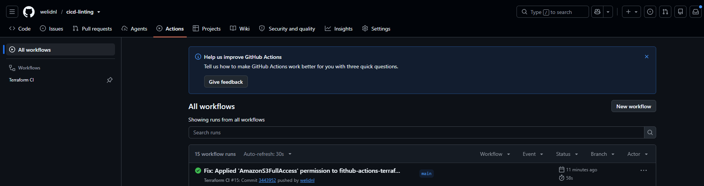
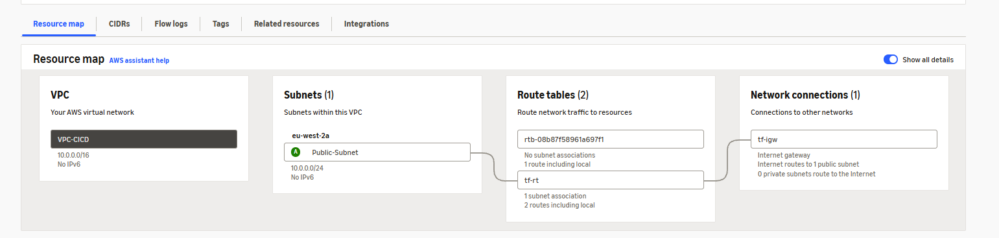
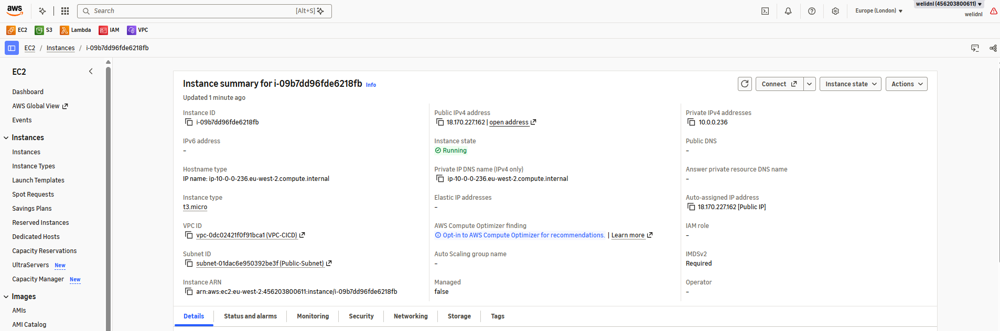
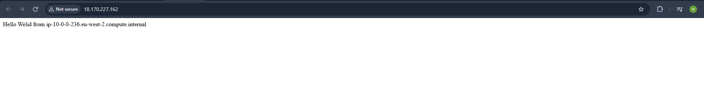

## Terraform CI/CD Pipeline

This project uses GitHub Actions to automatically validate and deploy AWS infrastructure defined with Terraform. It provisions a VPC with a public subnet and an EC2 web server running Apache.

### Pipeline Overview

| Stage | Status | Description |
|-------|--------|-------------|
| CI | Present | Lints, validates and plans the Terraform code on every push |
| CD | Present | Applies the configuration to AWS with `terraform apply` |

### How It Works

The workflow lives at `.github/workflows/terraform.yml` and runs as a single `terraform` job on an `ubuntu-latest` runner.

**Triggers**
- Every push to the repository

**Steps**

*Setup*

1. **Checkout code** (`actions/checkout@v7`) clones the repository onto the runner.
2. **Configure AWS credentials** (`aws-actions/configure-aws-credentials@v4`) authenticates to AWS by assuming an IAM role through OIDC, so no access keys are stored in GitHub.
3. **Setup Terraform** (`hashicorp/setup-terraform@v3`) installs Terraform 1.11.0.

*Continuous Integration (CI)*

4. **TFLint** (`devops-infra/action-tflint`) checks the Terraform files for errors and bad practices.
5. **Terraform init** downloads the AWS provider and initialises the working directory.
6. **Terraform validate** checks that the configuration is syntactically valid.
7. **Terraform plan** previews the changes Terraform would make without applying them.

*Continuous Deployment (CD)*

8. **Terraform apply** (`-auto-approve`) creates or updates the infrastructure in AWS.

**Authentication (OIDC)**

The workflow requests an OIDC token (`id-token: write`) and exchanges it for temporary credentials by assuming the `github-actions-terraform` IAM role in `eu-west-2`. This role needs a trust policy that allows GitHub's OIDC provider to assume it from this repository.

### Remote State (S3 Backend)

Terraform's state file is stored remotely in an **S3 bucket** (`terraform-state-welid`, key `terraform.tfstate`) instead of on the GitHub Actions runner. The runner is destroyed after every run, so without remote state each push would start with no record of existing resources and create duplicates. With the S3 backend, every run reads the current state, works out only what has changed, and saves the updated state back.

The `github-actions-terraform` IAM role has been granted the `AmazonS3fullAccess` permission to allow for this.

### Infrastructure

| Resource | Purpose |
|----------|---------|
| `aws_vpc` | Private network (`10.0.0.0/16`) |
| `aws_subnet` | Public subnet (`10.0.0.0/24`) in `eu-west-2a` |
| `aws_internet_gateway` | Gives the VPC internet access |
| `aws_route_table` + association | Routes outbound traffic from the subnet to the internet gateway |
| `aws_security_group` | Allows inbound HTTP (port 80) from anywhere and all outbound traffic |
| `aws_instance` | `t3.micro` EC2 instance that installs and starts Apache on boot |

The instance's `user_data` script installs `httpd` and serves a page that reads `Hello Welid from <hostname>`.

**File structure**

```text
.
├── .github/
│   └── workflows/
│       └── terraform.yml   # CI/CD workflow
├── main.tf                 # EC2 instance and security group
├── network.tf              # VPC, subnet, internet gateway, routing
├── provider.tf             # AWS provider configuration
├── variables.tf            # Input variables and outputs
└── terraform.tfvars        # Variable values
```

**Variables**

Values are set in `terraform.tfvars`: `region`, `availability_zone`, `instance_type`, `instance_ami`, `vpc_cidr`, `subnet_cidr` and `route_cidr`.

**Outputs**

| Output | Description |
|--------|-------------|
| `EC2_ID` | The ID of the EC2 instance |

### Testing the Deployment

Once the workflow succeeds, find the instance's public IP in the AWS console and open it in a browser:

```text
http://http://18.170.227.162/>
```

### Screenshots

**Successful GitHub Actions run**



**VPC Routemap**



**EC2 Instance**


**Web server response**

